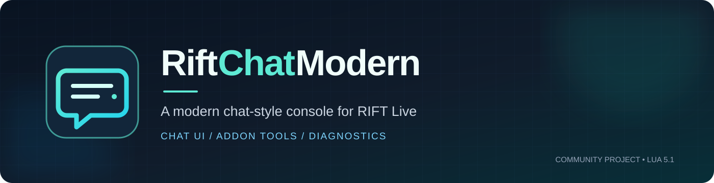
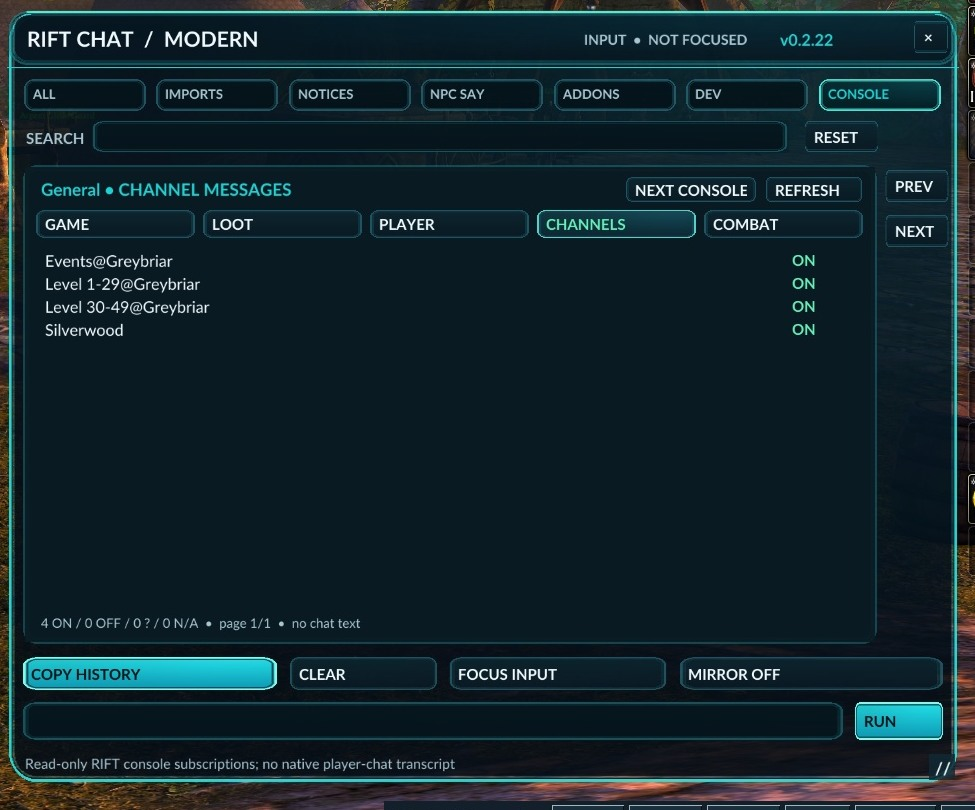

<div align="center">



<br/>

**A modern, draggable chat-style console and developer diagnostics hub for RIFT Live.**

[](addon/RiftChatModern/RiftAddon.toc)
[](https://www.trionworlds.com/rift/)
[](addon/RiftChatModern/)
[](#project-status)

[Features](#what-rcm-can-do) · [Roadmap](ROADMAP.md) · [Screenshot](#in-game-preview) · [Installation](#install-and-launch) · [Commands](#quick-command-reference) · [Addon API](#for-addon-developers) · [Documentation](#documentation)

</div>

---

## A cleaner window for RIFT development

**RiftChatModern (RCM)** is an original Lua addon for the RIFT Live client. It brings a readable dark interface, searchable message history, addon diagnostics, and an extensible local command editor into one movable, resizable window.

RCM is built to support other RIFT addons as a shared diagnostics surface—not just to look like a chat window. It provides a published addon API for messages, local commands, history inspection, and development tools.

> [!IMPORTANT]
> **RCM is not yet a complete replacement for RIFT's original player chat.** Two supervised real Say imports have been physically verified: the original manual route and, later on November 21, the **bounded follower → serialized coordinator → RCM editor → character save** route. The latter has an exact on-disk transfer receipt, but **unattended continuous reception and native addon-API social interception are not established**. The live log also revealed a real numbered public-channel format, now parsed on the Windows side but not yet imported through a physically accepted public-channel route. Guild, Party, Tell and direct native social sending remain unverified. The original RIFT chat stays available; host imports remain explicitly labeled.

## In-game preview

<div align="center">


<sub>Historical real RIFT Live screenshot of **RCM v0.2.22** (November 21, 2026), showing read-only public-channel subscriptions returned by the game. **Current addon: v0.2.23.** Cropped to exclude the player name and private HUD. No simulated transcript. [Previous v0.2.21 UI](assets/screenshots/rcm-v0.2.21-live-ui-cropped.jpg) and [redacted v0.2.2 image](assets/screenshots/rcm-v0.2.2-physical-names-redacted.png) remain available.</sub>
</div>

## What RCM can do

| | Feature | Details |
|:--:|---|---|
| 🖥️ | **Glass UI (v0.2.20)** | Translucent charcoal PNG surfaces, cyan outlines, responsive hover tabs, readable fonts, saved placement and dimensions |
| 💬 | **Separated message columns (v0.2.21)** | Local timestamps to seconds, colored channel labels, sender names, and independently sized message previews |
| 💬 | **Accurately labeled message history** | All, Imports, Notices, NPC Say, Addons, Dev; former Chat alias preserved as `:filter chat` |
| 🔎 | **Find and inspect** | Search, paginated history, expandable message details, copy/export |
| ⌨️ | **Local command editor** | Dedicated input, focus feedback, local `:` commands, session-only command recall |
| 🧩 | **Addon integration** | Publish diagnostics, register commands, subscribe to messages, inspect history |
| 🛠️ | **Native CONSOLE inspector (v0.2.22)** | Read-only Game, Loot, Player, public Channel and Combat subscriptions; actual ON/OFF states, console selector and refresh |
| 📥 | **Physically proven Say import (v0.2.23)** | Two supervised real Say imports independently verified, including the new serialized coordinator with exact on-disk transfer receipt |
| ⏱️ | **Bounded Say follower (Windows helper)** | Read-only monitoring of newly appended, physically observed Say syntax; metadata redacted by default; opt-in editor import preparation without in-game submission |
| 📦 | **Serialized Say delivery coordinator (Windows helper)** | Private durable queue, one in-flight transfer, .NET 10 validation, explicitly pinned send, exact-token disk verification and no automatic retries |
| 🌐 | **Bounded public-channel companion (Windows helper)** | Separately queued Level 1-29 / slot 4 host imports; exact public wire validation, global cross-profile editor lock, .NET sender preflight and disk-token proof; physical public import not yet accepted |
| 💾 | **Persistence** | Character-scoped SavedVariables with schema migration and save-status diagnostics |

<sub>Feature support varies between offline Lua 5.1 regression tests and physical in-game acceptance. See [verified status and limitations](#project-status).</sub>

## Install and launch

RCM is a **RIFT Live addon**. It does not require an external host tool for the core in-game window.

1. Download or clone this repository.
2. Copy the contents of [`addon/RiftChatModern`](addon/RiftChatModern/) into your RIFT AddOns directory, preserving the folder structure and `RiftAddon.toc`.
3. Start RIFT, or if the addon is already installed, type `/reloadui` in **RIFT's original chat** to load updated Lua files.
4. Type `/rcm` or `/rcm show` in the original chat to open the RCM window.

The usual Windows folder is beneath `Documents\RIFT\Interface\AddOns\`; installations using OneDrive may redirect Documents. **Use your actual RIFT documents location**, not a hardcoded example path.

```text
RIFT/
└── Interface/
    └── AddOns/
        └── RiftChatModern/
            ├── RiftAddon.toc
            ├── Core.lua
            ├── AddonMessages.lua
            ├── NativeChatProbe.lua
            ├── ConsoleMirror.lua
            ├── HostIngress.lua
            ├── Main.lua
            ├── fonts/
            └── textures/       # 12 original glass UI assets
```

> [!TIP]
> For development on the configured AMD-DESKTOP workstation, `tools/deploy_rcm.py` offers a guarded dry-run and hash-verified deployment. **An existing addon can be updated while RIFT is running; use `/reloadui` afterward.** See [deployment policy](docs/LIVE_DEPLOYMENT_RELOADUI_POLICY_20261120.md).

## Quick command reference

### In original RIFT chat

| Command | Action |
|---|---|
| `/rcm` | Toggle the RCM window |
| `/rcm show` / `/rcm hide` | Show or hide the window |
| `/rcm focus` | Focus the RCM editor |
| `/rcm tab addons` | Show addon messages |
| `/rcm find text` | Search messages |
| `/rcm size 1000 750` | Resize the window |
| `/rcm status` | Show addon status |
| `/rcm help` | Show available commands |

### In RCM's own editor

| Command | Action |
|---|---|
| `:help` | List local commands |
| `:status` | View current status |
| `:filter addons` | Filter addon messages |
| `:find text` | Search history |
| `:echo Hello` | Create a local developer message |
| `:native channels` | Inspect console channel metadata (not chat transcripts) |
| `:host status` | Inspect the manual host-import receiver |
| `:mirror status` | Inspect optional addon-console mirroring |
| `:copy` | Copy the filtered history |

**Note:** Typing a normal social-chat message into the RCM editor does **not** automatically send it to RIFT's original social channels.

### Windows host companion (optional)

Run `node tools/rcm-say-delivery.cjs status` from the repository root to inspect its private Say-transfer queue. An explicitly started capture can collect newly appended real-log Say-shaped messages, and `preflight` validates one queued batch through the real .NET 10 sender without game input. An opt-in `dispatch` requires fresh, fully pinned RIFT process identity and focus acknowledgments; **one supervised coordinator Say transfer has now passed real-game and disk acceptance**, while unattended continuous delivery remains unverified. Read the [physical coordinator acceptance](docs/COORDINATOR_PHYSICAL_ACCEPTANCE_20261121.md) and [delivery contract](docs/SAY_DELIVERY_COORDINATOR_20261121.md) before using it. This is a host-side tool, not a new Lua chat API.

## For addon developers

RCM exposes `RiftChatModernAPI` as an addon-to-addon integration surface. Consumers should declare a dependency on RCM in their own addon manifest.

```lua
Dependencies = { RiftChatModern = {"required", "before"} }
```

```lua
local rcm = _G.RiftChatModernAPI

if rcm and rcm.interfaceVersion == 2 then
    rcm.Publish("addons", "Position sampler ready", "RR2")

    rcm.RegisterCommand("rr2", function(args)
        if args == "status" then
            return "RR2: running"
        end
        return "Usage: :rr2 status"
    end)
end
```

The API also provides history retrieval, subscriptions, UI controls, copy helpers, native console metadata, and addon-data messaging. **Addon-data transport is not ordinary player-chat transport.** See the [full API and engineering contract](docs/ENGINEERING_ARCHIVE_README_THROUGH_20261121.md#universal-addon-api).

## Project status

| Area | Current evidence |
|---|---|
| **Addon release** | **v0.2.23**, physically loaded in RIFT Live; the retained real Say import displays as **`[HOST/SAY]`** without a duplicate |
| **Physical RIFT evidence** | v0.2.22 General, Loot and named public-channel subscriptions confirmed in native screenshots; v0.2.21 drag/resize, focus, details, message columns previously accepted |
| **Offline regression suite** | **315 Python/Lua and 119 Node tests passed** (November 21, 2026), including serialized Say queue, .NET sender dry-run/refusal, exact-token disk auditing, physical UI regressions and SavedVariables geometry audit |
| **Persistence** | Window position and size survived `/reloadui`; exact UI geometry and local DEV test entry independently found in the on-disk SavedVariables file |
| **Windows host tooling** | Existing .NET 10 editor batch validator, exact-candidate gate; temporary RIFT foreground capture/return physically verified |
| **Native player social chat** | Two supervised real **Say** imports accepted; 20 game-created numbered public-channel log lines establish one additional parser format, but public import and Guild/Party/Tell remain unverified |
| **Bounded host Say monitoring** | New-only follower physically captured one real Say during a bounded, supervised session; not unattended continuous reception |
| **Serialized host delivery** | **Physical P0 pass:** exactly one real Say transferred through coordinator to RCM and independently verified on disk under matching token |
| **Public-channel host delivery** | New Level 1-29 / slot 4 queue, bounded follower, .NET sender preflight and disk-auditor integration **offline tested**; live delivery is pending after a foreground-refused no-input log activation attempt |
| **Continuous unattended in-game import** | **Not yet implemented**; both verified Say transfers required explicit, supervised host actions |

RCM is under active development. The main engineering priority is proving a reliable real-game social chat source, without mislabeling host-imported records or RIFT console configuration as a native chat transcript.

## Documentation

The homepage is intentionally concise. The complete development history—including failed experiments, regressions, design decisions, and verification evidence—has **not been discarded**.

| Start here | Purpose |
|---|---|
| 🧭 [Current development roadmap](ROADMAP.md) | Canonical priorities, dependency gates, measurable acceptance criteria and current project board |
| 🎨 [v0.2.20 Glass UI](docs/V0_2_20_GLASS_UI_20261121.md) | Original PNG skin, interactive Lua styling, compatibility tests, and physical acceptance checklist |
| 📸 [Real v0.2.20 RIFT screenshot evidence](docs/V0_2_20_NATIVE_SCREENSHOT_ACCEPTANCE_20261121.md) | Verified in-game screen capture and managed temporary foreground; private image not published |
| 💬 [v0.2.21 Message columns](docs/V0_2_21_MESSAGE_COLUMNS_20261121.md) | Local seconds, distinct source/channel/message fields, responsive layout and test evidence |
| 📷 [v0.2.21 Physical UI acceptance](docs/V0_2_21_PHYSICAL_ACCEPTANCE_20261121.md) | Native screenshot receipts, real tab tests, modal root-cause fix, failed experiments and verified recovery |
| 🖱️ [v0.2.21 Drag, resize, editor and persistence](docs/V0_2_21_UI_INTERACTION_ACCEPTANCE_20261121.md) | Physical mouse and keyboard acceptance, reload and on-disk state, focus-restoration hardening |
| 🎛️ [v0.2.22 Native RIFT console categories](docs/V0_2_22_NATIVE_RIFT_CONSOLE_CATEGORIES_20261121.md) | Exact game categories, API research, physical ON/OFF evidence and unsupported native social chat boundary |
| 📥 [v0.2.23 Real Say → RCM import](docs/V0_2_23_PHYSICAL_RIFT_SAY_LOG_IMPORT_20261121.md) | Physical game-created log record, qualified parser, exact single editor import and on-disk SavedVariables proof |
| ⏱️ [Bounded Say follow (host-only)](docs/BOUNDED_SAY_FOLLOW_20261121.md) | New-only multi-message log monitoring, redacted by default; opt-in batches but no automatic RIFT delivery |
| 📦 [Serialized Say delivery coordinator](docs/SAY_DELIVERY_COORDINATOR_20261121.md) | Private durable queue, one claimed import, explicitly pinned .NET sender and exact SavedVariables token audit |
| ✅ [First physical coordinator acceptance](docs/COORDINATOR_PHYSICAL_ACCEPTANCE_20261121.md) | New live Say → serialized transfer → in-game HOST/SAY row → /reloadui → independently verified disk token |
| 🌐 [Real numbered public chat log format](docs/LIVE_PUBLIC_CHANNEL_LOG_FORMAT_20261121.md) | Twenty authentic current-client lines and strict Windows parser |
| 📦 [Public-channel companion pipeline](docs/PUBLIC_CHANNEL_DELIVERY_20261121.md) | Bounded public follower, independent private journal and coordinator, no-input validation and disk-token proof; physical public import pending |
| 🧭 [Evening public-channel handoff](docs/HANDOFF_20261121_EVENING_PUBLIC.md) | Current 8:55 PM checkpoint, source and test map, actual blockers, privacy and exact next physical test |
| 🧭 [Saturday development handoff](docs/HANDOFF_20261121_SATURDAY.md) | Complete November 21 recovery context, verified evidence, tests, known gaps and precise next-cycle acceptance sequence |
| 📚 [Complete engineering archive](docs/ENGINEERING_ARCHIVE_README_THROUGH_20261121.md) | Previous detailed README, preserved in full |
| 🧭 [Development history](docs/DEVELOPMENT_HISTORY_CONCEPT_TO_V0_2_2.md) | Original concept, initial build, fixes, and live findings |
| 🧱 [Addon transport](docs/ADDON_TRANSPORT.md) | RIFT addon-data messaging and API constraints |
| 🔧 [Deployment and `/reloadui`](docs/LIVE_DEPLOYMENT_RELOADUI_POLICY_20261120.md) | Installation and hot-update rules |
| 📥 [Multipart import fix](docs/V0_2_19_MULTIPART_IDLE_TIMEOUT_20261120.md) | Previous Lua-side receiver reliability change |
| 🖥️ [Windows batch sender](docs/RCM_MULTIPART_EDITOR_BATCH_20261121.md) | Guarded .NET host transfer prototype |
| 🔍 [Exact-chat observer gate](docs/RCM_LOG_OBSERVER_BATCH_GATE_20261121.md) | Candidate selection and evidence boundaries |
| 🧪 [Native log investigation](docs/RIFT_NOV17_NONCOMBAT_LINE_WRITER_20261120.md) | Exact-build reverse-engineering evidence |

## Contributing and verification

This is an independent community addon. Bug reports and reproducible test cases are welcome through [GitHub Issues](https://github.com/360madden/RiftChatModern/issues). Read the [contribution guide](CONTRIBUTING.md) before submitting changes.

To run the Windows development regression suite, use the configured Python environment with **Lua 5.1 via Lupa**, plus Node.js and the .NET 10 SDK for host-tool tests:

```powershell
& "C:\work\riftreader2\.venv\Scripts\python.exe" -m unittest discover -s tests
node --test tests/test_chat_import.cjs tests/test_chat_observer.cjs tests/test_chat_observer_cli.cjs tests/test_chat_batch_gate.cjs tests/test_live_say_batch.cjs tests/test_live_say_follow.cjs tests/test_live_public_follow.cjs tests/test_say_delivery.cjs tests/test_public_delivery.cjs
```

The local Python path above is a developer-workstation example, **not** an end-user installation requirement.

---

<div align="center">


**RiftChatModern** · Built for RIFT Live addon development

<sub>Independent community project · Not affiliated with the RIFT publisher</sub>
</div>
